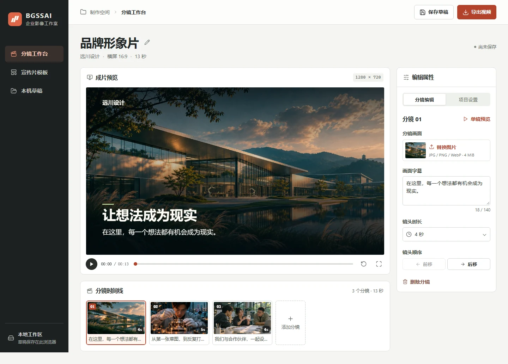

# BGSSAI 企业宣传片制作平台

在浏览器中用企业照片和品牌文案制作宣传视频。选择品牌形象、产品推介或团队招募模板，填写片名与企业名称，替换分镜素材、编排字幕和时长，即可预览并导出横版或竖版成片。

首版支持本地草稿、品牌色和片尾行动文案。图片与草稿保存在当前浏览器。导出需要保持标签页在前台，生成的无声视频采用当前浏览器可用的 MP4 或 WebM 格式。



## 本地启动

需要 JDK 21、Maven 3.9 和 Node.js 22.12+。从仓库根目录运行：

```sh
npm --prefix bgssai-corporate-user/bgssai-corporate-user-react ci
npm --prefix bgssai-corporate-user/bgssai-corporate-user-react run build:deploy
mvn clean verify
java -jar bgssai-corporate-user/bgssai-corporate-user/target/bgssai-corporate-user-0.1.0-SNAPSHOT.jar --spring.profiles.active=dev
```

打开 `http://localhost:8080/`。前端开发可另开终端运行 `npm --prefix bgssai-corporate-user/bgssai-corporate-user-react run dev`，通过 Vite 的 `/api` 代理访问本地后端。服务端不需要数据库或模型密钥。

## 发布与验收

用户端以一个 Spring Boot JAR 交付，包含前端、模板和示例图片。根目录 `Jenkinsfile` 接入 BGSSAI 共享库，服务名为 `bgssai-corporate-user`。dev、prod 均构建 `develop`，运行时分别加载 `application-dev.properties` 和 `application-prod.properties`。

Jenkins 主机清单使用 `CORPORATE_USER_HOST` 和目标端口 `CORPORATE_USER_PORT`。就绪探针为 `GET /bgssai/health/readiness`。部署验收还应打开工作台、读取 `GET /api/templates` 并播放一个已导出的成片。

[制作流程和数据契约](docs/feature/corporate-studio.md)
